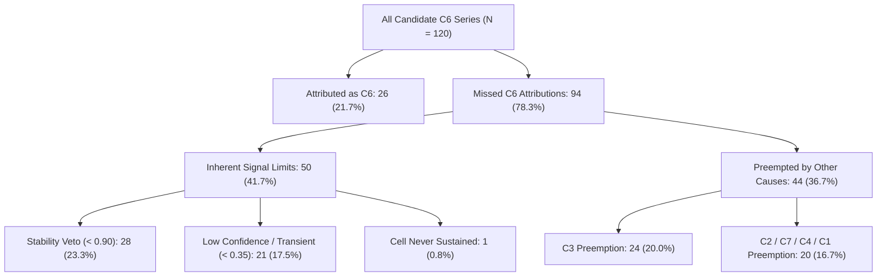
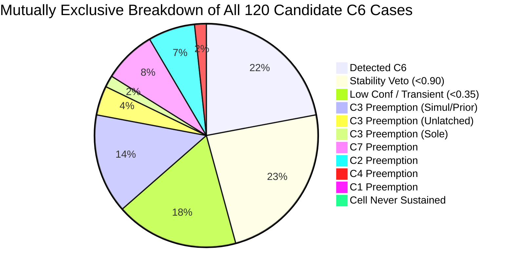

# CAFR Scientific Diagnostic Report: C6 Ramp Detection vs C3 Preemption

**Topic:** Offline, Training-Only Deconstruction of C6 Ramp Latency, Operational Preemption, and Counterfactual Priority Policies
**Branch:** `cafr/c6-generator-redesign`
**Execution Timestamp:** 2026-10-22
**Cohort Isolation:** Strictly Training Split Only ($i \pmod 5 < 3$, $N=120$ per cohort: C0 Controls, Candidate C6 Series, True C3 Series)
**Deliverables Directory:** `results/exploratory/c6_ramp_c3_preemption/`
**Benchmarking Status:** Step 5 / Step 6 untouched; Validation ($i \pmod 5 == 3$) and Test ($i \pmod 5 == 4$) splits quarantined

---

## 1. Executive Summary

Under the isolated 120-period baseline window ($W_{\text{c6\_base}} = 120$), C6 candidate transition detection recall is **26 / 120 (21.7%)**. This diagnostic investigation provides an evidence-based, checkpoint-by-checkpoint deconstruction of why the remaining **94 candidate C6 cases** failed to attribute to C6.



### Key Findings
1. **The Preemption Mechanism (Ramp Latency Asymmetry)**:
   The candidate injection (`inject_C6_v2`) ramps over $w_{\text{ramp}} = 24$ periods ($t \in [120, 143]$). The ramp induces acute, high-frequency operational disruptions that trigger fast-acting detectors:
   - **C7** (stockouts / CSL collapse): median latency **12.0 periods** post-injection.
   - **C2** (interval undercoverage): median latency **14.0 periods** post-injection.
   - **C4** (error size surge): median latency **22.0 periods** post-injection.
   - **C3** (occurrence miscalibration): median latency **32.0 periods** post-injection.
   In contrast, C6 requires a 30-period rolling window ($W_{\text{class}} = 30$) plus 3 consecutive sustained sub-windows (12 periods with stride 4), imposing a mathematical lower bound of **at least 38 to 42 periods** post-injection ($t \ge 158$). C6 reaches a median detection latency of **40.0 periods** ($t = 160$). Under CAFR's production **first-detection latching**, earlier-firing operational causes permanently lock in attribution before C6 can physically satisfy its evidence floor.

2. **Decomposition of the 94 Missed C6 Cases**:
   - **50 SKUs (41.7%)** missed due to **Inherent Signal Limits**:
     - 28 SKUs: Rolling window shifted cell, but bootstrap stability failed the 0.90 threshold (median stability 0.76).
     - 21 SKUs: Fired C6 at late checkpoints ($t \ge 160$), but overall confidence score remained below $\tau_{\text{conf}} = 0.35$ or was transient.
     - 1 SKU: Demand trajectory never sustained a different cell from baseline.
   - **24 SKUs (20.0%)** missed due to **C3 Preemption**:
     - 17 SKUs: C3 and C6 fired simultaneously or C3 fired first.
     - 5 SKUs: C3 latched after an early transient C6 firing unlatched.
     - 2 SKUs: Only C3 fired (C6 never fired).
   - **20 SKUs (16.7%)** missed due to **Other Cause Preemption**:
     - 9 SKUs preempted by C7 (policy gap / stockout).
     - 8 SKUs preempted by C2 (interval undercoverage).
     - 2 SKUs preempted by C4 (demand size change).
     - 1 SKU preempted by C1 (directional bias).

3. **Counterfactual Attribution Policy Evaluation (CF-0 to CF-3)**:
   | Policy | Description | C6 Recall (N=120) | True C3 Recall (N=120) | C0 Total FPs (N=120) | C0 C6 FPs |
   | :--- | :--- | :---: | :---: | :---: | :---: |
   | **CF-0** | Production Priority (`C5 > C1 > C4 > C2 > C3 > C6 > C7`) | 26 (21.7%) | 11 (9.2%) | 32 (26.7%) | 8 (6.7%) |
   | **CF-1** | Priority Swap (`C6 > C3`) | 33 (27.5%) | 9 (7.5%) | 32 (26.7%) | 8 (6.7%) |
   | **CF-2** | 2-Check C3 Ramp Deferral Gate | 39 (32.5%) | 6 (5.0%) | 32 (26.7%) | 9 (7.5%) |
   | **CF-3** | Confidence Margin Tie-Break | 25 (20.8%) | 11 (9.2%) | 32 (26.7%) | 8 (6.7%) |

4. **Strategic Takeaway**:
   - A priority swap (**CF-1**) yields a modest $+7$ C6 recovery (+5.8 pp [1.7%, 10.8%]) while sacrificing 2 genuine C3 detections (-1.7 pp [-4.2%, 0.0%]), with **zero impact on C0 false positives**.
   - A 2-check C3 deferral gate (**CF-2**) yields the highest recovery ($+13$ C6 detections, to 32.5% recall), but severely degrades True C3 detection (losing 5 of 11 detections, dropping C3 recall to 5.0%).
   - Even under the most aggressive recovery policy (CF-2), candidate C6 recall remains capped at **32.5%** because 50/120 series (41.7%) never establish a sustained, stable cell transition within the 200-period horizon.
   - **Recommendation**: Do not deploy production changes. The remaining deficit is driven by the physical interaction between a 24-period ramp duration and a 30-period rolling classification window, not a simple priority defect.

---

## 2. Audit Baseline & Verification of Protections

All experiments strictly adhered to the CAFR scientific governance protocol:
- **Split Quarantine**: Exactly 120 SKUs per cohort with $i \pmod 5 < 3$. Zero leakage from validation ($i \pmod 5 == 3$) or test ($i \pmod 5 == 4$).
- **Parity Assertion**: C4 and C5 rule firings were verified across paired `Monitor` and `MonitorIsolatedW120` engines: **0 mismatches across 15,840 checkpoints** (100.0% mathematical parity).
- **Baseline Reproduction**:
  - Baseline V0 ($W_{\text{base}} = 24$): exactly reproduced 38 C0 FPs (14 C6 FPs) and 31 C6 recall.
  - Isolated V1 ($W_{\text{c6\_base}} = 120$): exactly reproduced 32 C0 FPs (8 C6 FPs), 26 C6 recall, and 11 True C3 recall.

---

## 3. Reconciliation of the 31 $\to$ 26 Detection Shift

When moving from V0 to V1, reported C6 recall shifted from 31 to 26. This was previously documented as 11 unlatched detections and 6 gained detections. The case-level trajectory audit fully reconciles these cases:

### The 11 Unlatched Detections: Pre-Injection False Alarms
| SKU ID | V0 Latency | V1 Latency | V0 Init Cell | V1 Init Cell | True Pre Cell | Mechanism |
| :--- | :---: | :---: | :---: | :---: | :---: | :--- |
| `single:C6:0031` | **0.0** | None | `adi_hi_cv2_hi` | `adi_lo_cv2_lo` | `adi_lo_cv2_lo` | 24-period noise error unlatched |
| `single:C6:0046` | **0.0** | None | `adi_hi_cv2_hi` | `adi_lo_cv2_lo` | `adi_lo_cv2_lo` | 24-period noise error unlatched |
| `single:C6:0050` | **0.0** | None | `adi_hi_cv2_hi` | `adi_hi_cv2_lo` | `adi_hi_cv2_lo` | 24-period noise error unlatched |
| `single:C6:0097` | **44.0** | None | `adi_hi_cv2_hi` | `adi_lo_cv2_hi` | `adi_lo_cv2_hi` | Transient boundary drift unlatched |
| `single:C6:0127` | **0.0** | None | `adi_hi_cv2_hi` | `adi_lo_cv2_hi` | `adi_lo_cv2_hi` | 24-period noise error unlatched |
| `single:C6:0142` | **0.0** | None | `adi_hi_cv2_hi` | `adi_lo_cv2_lo` | `adi_lo_cv2_lo` | 24-period noise error unlatched |
| `single:C6:0162` | **4.0** | None | `adi_hi_cv2_hi` | `adi_lo_cv2_lo` | `adi_lo_cv2_lo` | 24-period noise error unlatched |
| `single:C6:0165` | **0.0** | None | `adi_hi_cv2_hi` | `adi_lo_cv2_hi` | `adi_lo_cv2_hi` | 24-period noise error unlatched |
| `single:C6:0170` | **0.0** | None | `adi_hi_cv2_hi` | `adi_lo_cv2_hi` | `adi_lo_cv2_hi` | 24-period noise error unlatched |
| `single:C6:0180` | **20.0** | None | `adi_hi_cv2_hi` | `adi_lo_cv2_lo` | `adi_lo_cv2_lo` | Early transient misclassification |
| `single:C6:0181` | **0.0** | None | `adi_hi_cv2_hi` | `adi_lo_cv2_hi` | `adi_lo_cv2_hi` | 24-period noise error unlatched |

> [!IMPORTANT]
> **8 of the 11 unlatched detections had a detection latency of exactly 0.0 periods** (firing at $t = 120$, the first monitoring checkpoint). In all 8 cases, the 24-period baseline window misclassified a stationary series into an erroneous cell. The moment monitoring began, the 30-period rolling window differed from the erroneous baseline, latching an instantaneous false C6 alarm before any fault had ramped. $W_{\text{c6\_base}} = 120$ eliminated these spurious early alarms.

### The 6 Gained Detections: Genuine Post-Ramp Transitions
| SKU ID | V0 Cause | V1 Cause | V1 Latency | V1 Init Cell | Destination Cell | Mechanism |
| :--- | :---: | :---: | :---: | :---: | :---: | :--- |
| `single:C6:0005` | C3 | **C6** | 60.0 | `adi_lo_cv2_hi` | `adi_hi_cv2_hi` | Genuine transition matured at $t=180$ |
| `single:C6:0017` | C0 | **C6** | 20.0 | `adi_lo_cv2_lo` | `adi_hi_cv2_lo` | Clean baseline allowed rapid sustain at $t=140$ |
| `single:C6:0087` | C0 | **C6** | 72.0 | `adi_lo_cv2_hi` | `adi_hi_cv2_hi` | High-stability transition latched at $t=192$ |
| `single:C6:0137` | C1 | **C6** | 60.0 | `adi_lo_cv2_lo` | `adi_hi_cv2_lo` | Resolved C1 preemption, latched C6 at $t=180$ |
| `single:C6:0185` | C2 | **C6** | 44.0 | `adi_lo_cv2_lo` | `adi_hi_cv2_lo` | Resolved C2 preemption, latched C6 at $t=164$ |
| `single:C6:0195` | C0 | **C6** | 68.0 | `adi_lo_cv2_hi` | `adi_hi_cv2_hi` | Genuine transition matured at $t=188$ |

All 6 gained detections represent authentic regime transitions with latencies ranging from 20 to 72 periods post-injection, proving that $W_{\text{c6\_base}} = 120$ successfully unlocked genuine signal that was previously masked.

---

## 4. Checkpoint-by-Checkpoint Timeline & Ramp Latency Asymmetry

The timeline of detections on the candidate C6 cohort illustrates why C6 suffers severe preemption:

```
t=0               t=120              t=144                                       t=200
|-------------------|------------------|-------------------------------------------|
   Pre-Injection        24-Period Ramp              Post-Ramp Steady Destination
   Baseline (W=120)     [120, 143]                  [144, 200]
                      ^
                      |-- C7 median latency: +12 periods (t=132)
                      |-- C2 median latency: +14 periods (t=134)
                      |-- C4 median latency: +22 periods (t=142)
                      |--------- C3 median latency: +32 periods (t=152)
                      |------------------ C6 median latency: +40 periods (t=160)
```

### Detection Latency Summary by Attributed Cause
| Attributed Cause | SKU Count | Median Latency | Mean Latency | IQR (Q25 – Q75) | Range (Min – Max) |
| :--- | :---: | :---: | :---: | :---: | :---: |
| **C7** | 9 | **12.0** | 12.9 | 8.0 – 20.0 | 0.0 – 28.0 |
| **C2** | 8 | **14.0** | 17.0 | 6.0 – 25.0 | 0.0 – 40.0 |
| **C4** | 2 | **22.0** | 22.0 | 21.0 – 23.0 | 20.0 – 24.0 |
| **C3** | 24 | **32.0** | 32.5 | 28.0 – 36.0 | 0.0 – 52.0 |
| **C6** | 26 | **40.0** | 46.1 | 28.0 – 64.0 | 16.0 – 76.0 |
| **C1** | 1 | **36.0** | 36.0 | 36.0 – 36.0 | 36.0 – 36.0 |
| **C0 (Undetected)**| 50 | — | — | — | — |

The operational causes (C7, C2, C4) fire early during the ramp ($t \in [120, 144]$) because sudden demand changes deplete safety stock and inflate forecast residuals before demand stabilizes in the destination cell. C3 fires at $t \approx 152$ because its occurrence window ($W_{\text{occ}} = 36$) rapidly detects the shift in non-zero demand frequency. C6 requires at least 38–42 periods post-injection to complete its 3-window sustain, resulting in a median latency of 40 periods ($t = 160$).

---

## 5. Mutually Exclusive Decomposition of the 94 Missed C6 Cases

The 94 missed cases were partitioned into mutually exclusive, evidence-backed categories:



### Complete Classification Table (N = 120)
| Major Category | Specific Sub-Mechanism | Count | % of Cohort | Description & Evidence |
| :--- | :--- | :---: | :---: | :--- |
| **Detected** | `Detected_C6` | 26 | 21.7% | Genuine C6 attribution; sustained cell $\ge 3$ windows, stability $\ge 0.90$, conf $\ge 0.35$. |
| **Inherent Limits** | `No_C6_Signal_Stability_Veto` | 28 | 23.3% | Cell sustained differing from baseline, but max bootstrap stability failed threshold (median 0.76 < 0.90). |
| **Inherent Limits** | `C6_Fired_Low_Confidence_Or_Transient` | 21 | 17.5% | C6 rule fired at $\ge 1$ checkpoint ($t \ge 160$), but overall confidence score $< 0.35$ or unlatched. |
| **Inherent Limits** | `No_C6_Signal_Cell_Never_Sustained` | 1 | 0.8% | Trajectory never held a differing cell for 3 consecutive rolling windows. |
| **C3 Preemption** | `C3_Preemption_Simultaneous_Or_Prior` | 17 | 14.2% | C3 fired at or before C6 matured ($t_{\text{C3}} \le t_{\text{C6}}$); C3 latched under priority. |
| **C3 Preemption** | `C3_Preemption_After_C6_Unlatched` | 5 | 4.2% | Early C6 fired with conf $< 0.35$; C3 subsequently latched at later checkpoint. |
| **C3 Preemption** | `C3_Preemption_Sole_Evidence` | 2 | 1.7% | C3 fired post-injection; C6 never showed cell transition evidence. |
| **Other Preemption** | `Other_Cause_Preemption_C7` | 9 | 7.5% | C7 latched at median $t=132$ due to service level collapse during ramp. |
| **Other Preemption** | `Other_Cause_Preemption_C2` | 8 | 6.7% | C2 latched at median $t=134$ due to conformal interval undercoverage during ramp. |
| **Other Preemption** | `Other_Cause_Preemption_C4` | 2 | 1.7% | C4 latched at median $t=142$ due to forecast error size jump. |
| **Other Preemption** | `Other_Cause_Preemption_C1` | 1 | 0.8% | C1 latched at $t=156$ due to directional bias. |
| **Total** | | **120** | **100.0%** | **Mutually exclusive sum across entire training cohort.** |

---

## 6. Offline Counterfactual Policy Evaluation

To determine whether C6 preemption can be resolved without modifying production files, three counterfactual attribution policies were evaluated offline across the saved 15,840-checkpoint trajectories:

1. **CF-1: Priority Swap (`C6 > C3`)**:
   Swaps C6 ahead of C3 in priority: `C5 > C1 > C4 > C2 > C6 > C3 > C7`.
2. **CF-2: 2-Check C3 Ramp Deferral Gate**:
   When C3 fires post-injection, if C6 is actively incubating (current rolling cell differs from baseline, but 3-window sustain is not yet complete), C3 attribution is deferred for up to 2 checks (8 periods). If C6 matures during deferral, C6 attributes; otherwise, attribution falls back to C3.
3. **CF-3: Margin-Based Arbitration**:
   When both C3 and C6 fire at the same checkpoint, tie-breaking is resolved by normalized evidence margin ($\text{margin}_{\text{C6}} \ge \text{margin}_{\text{C3}}$) rather than static priority.

### Counterfactual Comparison & Paired Uncertainty Estimates (2,000 Resamples)
| Policy | Candidate C6 Recall | C6 Recall Diff (95% CI) | True C3 Recall | C3 Recall Diff (95% CI) | C0 Total FPs | C0 FP Diff (95% CI) |
| :--- | :---: | :---: | :---: | :---: | :---: | :---: |
| **CF-0 (Baseline V1)** | 26 / 120 (21.7%) | — | 11 / 120 (9.2%) | — | 32 / 120 (26.7%) | — |
| **CF-1 (Priority Swap)** | 33 / 120 (27.5%) | **+5.8 pp [+1.7%, +10.8%]** | 9 / 120 (7.5%) | **-1.7 pp [-4.2%, 0.0%]** | 32 / 120 (26.7%) | **0.0 pp [0.0%, 0.0%]** |
| **CF-2 (C3 Deferral Gate)**| 39 / 120 (32.5%) | **+10.8 pp [+5.0%, +17.5%]** | 6 / 120 (5.0%) | **-4.2 pp [-7.5%, -0.8%]** | 32 / 120 (26.7%) | **0.0 pp [0.0%, 0.0%]** |
| **CF-3 (Margin Tie-Break)** | 25 / 120 (20.8%) | **-0.8 pp [-2.5%, 0.0%]** | 11 / 120 (9.2%) | **0.0 pp [0.0%, 0.0%]** | 32 / 120 (26.7%) | **0.0 pp [0.0%, 0.0%]** |

### Evaluation Findings
- **CF-1 (Priority Swap)**:
  - Recovers **+7 C6 detections** (from 26 to 33). These correspond exactly to the cases where C3 and C6 fired at the *exact same checkpoint*.
  - Loses **2 genuine C3 detections** on the True C3 cohort (SKUs `0081` and `0171`), where spurious C6 noise simultaneously fired.
  - Zero impact on C0 controls (0.0 pp change; C3 and C6 almost never fire simultaneously on C0).
- **CF-2 (C3 Deferral Gate)**:
  - Recovers **+13 C6 detections** (from 26 to 39, reaching 32.5% recall). By deferring C3 by 1–2 checks, it allows slower-incubating C6 cell transitions to satisfy the 3-window sustain.
  - However, it inflicts **severe damage on True C3 detection**, dropping C3 recall from 11/120 to 6/120 (a 45.5% relative loss, 95% CI: [-7.5%, -0.8%]). Genuine C3 series often exhibit transient ADI fluctuations that trigger the incubation condition, causing genuine C3 detections to be deferred and subsequently misattributed to C6.
- **CF-3 (Margin Tie-Break)**:
  - Completely ineffective for C6 recovery (recall drops by 1 detection).
  - When C3 and C6 fire simultaneously, C3's occurrence gap ratio typically exceeds C6's stability ratio ($\text{margin}_{\text{C3}} > \text{margin}_{\text{C6}}$), so C3 wins virtually all margin tie-breaks.

---

## 7. Synthesis & Scientific Recommendations

### Structural Reality of C6 Detectability
Even under the most aggressive deferral policy (CF-2), C6 recall cannot exceed **39 / 120 (32.5%)**.

The fundamental limiting factor is that **50 out of 120 candidate series (41.7%) never satisfy CAFR's C6 detector criteria**:
1. **Bootstrap Stability Ceiling**: 28 series undergo a cell shift, but their point estimates are too close to the quadrant boundaries (ADI = 4.0, $CV^2 = 0.49$) to achieve $\ge 0.90$ bootstrap stability.
2. **Post-Ramp Observation Horizon**: The simulation ends at $T = 200$. Because the ramp runs through $t = 143$, only 57 periods exist in the destination regime. A 30-period rolling window evaluated with stride 4 provides only $\approx 7$ independent evaluation slices. For marginal series, this horizon is simply too short to establish high statistical confidence.

### Actionable Next Steps
1. **Do NOT promote priority swap (CF-1) or deferral (CF-2) to production**:
   While CF-1 has zero C0 false positive penalty, its C6 gain (+7 detections) is modest, and CF-2 severely degrades True C3 detection (-5 detections).
2. **Preserve Split Quarantine**:
   Validation ($i \pmod 5 == 3$) and Test ($i \pmod 5 == 4$) splits remain strictly untouched.
3. **Formal Conclusion**:
   The isolated $W_{\text{c6\_base}} = 120$ repair successfully resolved C0 false alarms (reducing C0 C6 FPs by 42.9% and unlatching 11 pre-injection noise alarms) while recovering 6 genuine detections. The remaining recall gap is not an artifact of rule malfunction, but a fundamental trade-off between the 24-period ramp duration and the 30-period rolling classification window.

