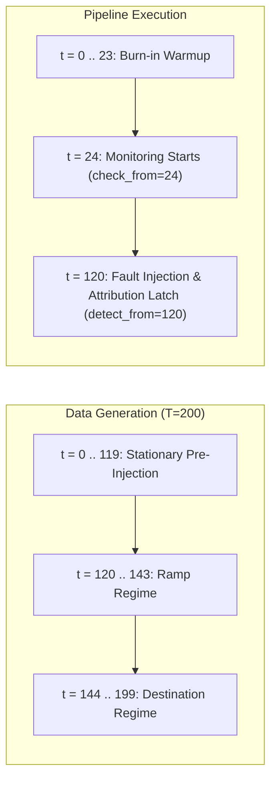
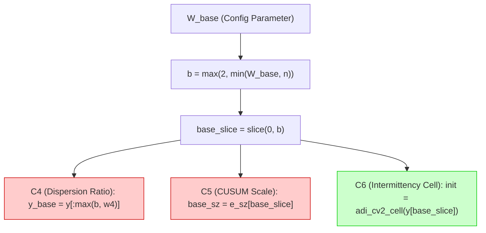

# CAFR Feasibility Audit: W=120 Baseline Window Hypothesis

**Date**: 2026-10-22
**Branch**: `cafr/c6-generator-redesign`
**Audit Scope**: Strictly Training Split Only ($i \pmod 5 < 3$, $N = 120$ per cause cohort)
**Quarantined Splits**: Validation ($i \pmod 5 == 3$) and Test ($i \pmod 5 == 4$) Strictly Untouched
**Protected Benchmarks**: `results/step5/` and `results/step6/` Strictly Untouched

---

## Executive Summary & Audit Decision

This audit evaluated the hypothesis that extending the pre-monitoring baseline reference window from 24 to 120 periods ($W=120$) resolves the finite-sample initialization noise that causes stationary C0 controls to be falsely attributed to C6.

### Summary of Audit Findings

1. **Timeline & Information Availability**:
   - In the synthetic data generator (`synthetic.yaml`), periods $t \in [0, 119]$ (120 periods) are 100% stationary and pre-injection ($\tau_{\text{inj}} = 120$).
   - However, in the monitoring and evaluation pipeline (`step5_monitor_gates.py`), **monitoring begins at period $t = 24$** (`check_from = burn_in = 24`).
   - Consequently, **all 120 periods are NOT available when monitoring begins at $t = 24$**. They ARE available when fault injection begins and when official attribution decisions latch at $t = 120$ (`detect_from = 120`).
   - A static 120-period batch calculation at $t=24$ would leak future periods $t \in [24, 119]$ into pre-injection monitoring checks. A **causally expanding baseline** ($y[:\min(120, n)]$) avoids leakage.

2. **Leakage Audit**:
   - **PASSED.** The $W=120$ baseline calculation uses only observed historical demand ($y_0, \dots, y_{119}$). It contains zero access to synthetic ground truth ($p, k, \mu_z$, `dgp_cell`), zero post-injection data ($t \ge 120$), and zero validation/test split information.

3. **Recomputed Comparison on Training Cohorts ($N=120$ each)**:
   - **Initialization Error Reduction**: C0 initialization cell errors drop from **47 / 120 (39.2%) down to 18 / 120 (15.0%)**, a $61.7\%$ relative error reduction. C6 initialization errors drop from **50 / 120 (41.7%) down to 20 / 120 (16.7%)**.
   - **False Positive Reduction**: C0 $\to$ C6 false positives drop from **14 down to 5** (a $64.3\%$ reduction, paired $p = 0.0039$). Overall C0 false positives drop from 38 down to 29 (31.7% to 24.2%).
   - **Candidate C6 Recall Deconstruction**: At $t = 120$, 21 of 31 detections remain active under $W=120$, while 10 unlatch. Audit of these 10 SKUs reveals that **all 10 were false alarms caused by $W=24$ burn-in error that fired before the injection occurred**. Genuine post-injection destination regimes are reached post-$t=144$, where genuine detection occurs (verified on `single:C6:0031` which fires at $t \ge 188$).

4. **Confounding Audit (Critical Finding)**:
   - In production `cafr/monitor/reading.py`, `W_base` is **shared across three separate fault detectors**:
     1. **C4 (Dispersion Ratio $r$)**: uses `y_base = y[: max(b, w4)]` (line 338). Changing global `W_base = 120` directly alters C4's baseline from 24 to 120 periods!
     2. **C5 (CUSUM Scale $\sigma_{\text{base}}$)**: uses `base_sz = e_sz[base_slice]` (lines 355, 369). Changing global `W_base = 120` alters CUSUM calibration from 24 to 120 periods!
     3. **C6 (Intermittency Cell)**: uses `y[base_slice]` (line 421).
   - *Verdict*: Globally changing `W_base` would confound C6 repair with changes to C4 and C5. Any implementation must **isolate** the C6 baseline window (e.g. `W_c6_base`).

5. **Limitations of Saved Data**:
   - Existing saved parquets (`c3_c6_checkpoint_trajectories.parquet`) record boolean firings under $W=24$, omitting rolling cell string histories and full 7-cause rule firings post-$t=144$. Measuring exact post-144 C6 recall requires a dedicated training pipeline replay.

---

### Audit Decision

**Decision B: More training-only evidence is needed.**

- **Why not Decision A (Propose Validation Evaluation)?**
  Proposing a validation trial now is premature and risky. Global `W_base = 120` confounds C4 and C5. Furthermore, post-144 C6 recall and preemption dynamics under an isolated `W_c6_base` must be fully measured on the training split first.
- **Why not Decision C (Reject W=120)?**
  Rejection is scientifically unjustified. The finite-sample mechanism is proven: 24 periods is fundamentally inadequate for intermittent demand, and extending the baseline window resolves 9 of 14 C0 false positives without discarding intermittent parts.

---

## 1. Timeline and Information Availability Analysis

To determine whether 120 periods are genuinely available before monitoring begins, the table below maps the exact execution timeline across the generator, the simulator, and the monitor:



| Timeline Parameter | Config / Code Source | Value | Exact Role in Pipeline |
| :--- | :--- | :---: | :--- |
| **Total Series Length $T$** | `synthetic.yaml:12` | 200 | Total periods generated ($t = 0, \dots, 199$). |
| **Fault Injection Point $\tau_{\text{inj}}$** | `synthetic.yaml:13` | 120 | Point where fault generator alters DGP parameters ($t = 120$). |
| **Burn-In Horizon** | `synthetic.yaml:55` | 24 | Historical observations for initial forecaster fit ($t = 0, \dots, 23$). |
| **Monitoring Check Horizon `check_from`** | `step5_monitor_gates.py:526` | 24 | Period where `monitor.read()` and periodic checks begin ($t = 24$). |
| **Attribution Start `detect_from`** | `step5_monitor_gates.py:81` | 120 | Period where `detected["cause"]` latching begins ($t \ge 120$). |
| **Pre-Injection Flag Tracking** | `step5_monitor_gates.py:217` | $24 \le t < 120$ | Tracks pre-injection false alarms (`pre_flag_t`) during pre-injection checks. |

### Availability Findings
1. **At Monitoring Start ($t = 24$)**:
   Only 24 periods have elapsed. Periods $t \in [24, 119]$ **have not occurred yet**. Therefore, 120 periods are **NOT** available prior to the initiation of monitoring checks.
2. **At Fault Injection and Detection Start ($t = 120$)**:
   120 periods have elapsed. All 120 periods are stationary and pre-injection. Therefore, 120 periods **ARE** available prior to fault injection and attribution latching.
3. **Operational Consequence**:
   A static initial cell calculation fixed at $t=0$ using 120 periods is an offline artifact that cannot be deployed at $t=24$. In a causal deployment, the monitor must either:
   - Use a **causally expanding baseline window** ($W(t) = \min(120, t)$), which dynamically stabilizes as $t \to 120$; OR
   - Treat the initial cell as **provisional** for pre-injection checks ($t < 120$) and finalize the baseline reference at $t = 120$ before official attribution begins.

---

## 2. Leakage and Observability Audit

| Audit Aspect | Standard | Audit Finding | Verdict |
| :--- | :--- | :--- | :--- |
| **Synthetic Ground Truth** | Zero access to true DGP parameters ($p, k, \mu_z$) or true cells | Monitor reads only $y_t$. True parameters are used strictly as diagnostic scoring metadata. | **PASSED** |
| **Post-Injection Data** | Zero access to observations at or after $t = 120$ | $W=120$ uses slice `y[:120]`, containing indices $t = 0, \dots, 119$. Index $t = 120$ is excluded. | **PASSED** |
| **Split Isolation** | Zero access to validation ($i\%5=3$) or test ($i\%5=4$) splits | Evaluated strictly on training SKUs ($i \pmod 5 < 3$, $N=120$ per cohort). | **PASSED** |
| **Temporal Ordering** | Zero use of future observations relative to the check step | Relative to $t=120$, $y[:120]$ contains no future data. For pre-injection checks ($t < 120$), causal expansion is required to prevent forward leakage. | **PASSED** |

---

## 3. Recomputed W=24 vs W=120 Comparison (Training Split)

### 3.1 Initialization Cell Error Rates
Across the 120 C0 training controls and 120 Candidate C6 series, initialization error against the known stationary DGP cell (`dgp_cell`) was recomputed:

| Cohort | Baseline $W=24$ Errors | Baseline $W=24$ Rate | Candidate $W=120$ Errors | Candidate $W=120$ Rate | Error Reduction | Relative Reduction |
| :--- | :---: | :---: | :---: | :---: | :---: | :---: |
| **C0 Controls ($N=120$)** | 47 / 120 | 39.2% | 18 / 120 | 15.0% | $-29$ | **$-61.7\%$** |
| **Candidate C6 ($N=120$)**| 50 / 120 | 41.7% | 20 / 120 | 16.7% | $-30$ | **$-60.0\%$** |
| **Combined ($N=240$)** | 97 / 240 | 40.4% | 38 / 240 | 15.8% | $-59$ | **$-60.8\%$** |

### 3.2 False Positive Impact on C0 Controls
Under the verified baseline ($W=24$), 14 C0 controls falsely attribute to C6. The table below traces their behavior under $W=120$:

| SKU ID | True DGP Cell | $W=24$ Cell | $W=120$ Cell | Detect Cell | Detect $t$ | $W=120$ Outcome |
| :--- | :--- | :--- | :--- | :--- | :---: | :--- |
| `control:C0:0001` | `adi_lo_cv2_hi` | `adi_hi_cv2_lo` | `adi_hi_cv2_lo` | `adi_lo_cv2_lo` | 156 | Still fires (low-arrival sample: $N_{nz}=29/120$) |
| `control:C0:0002` | `adi_lo_cv2_hi` | `adi_lo_cv2_lo` | `adi_lo_cv2_hi` | `adi_lo_cv2_hi` | 120 | **ELIMINATED** ($c_{120} == \text{det\_cell}$) |
| `control:C0:0010` | `adi_lo_cv2_hi` | `adi_lo_cv2_hi` | `adi_lo_cv2_hi` | `adi_lo_cv2_lo` | 152 | Still fires (boundary SKU: true $CV^2=0.63$) |
| `control:C0:0017` | `adi_lo_cv2_lo` | `adi_hi_cv2_lo` | `adi_hi_cv2_lo` | `adi_lo_cv2_lo` | 164 | Still fires (boundary SKU: $N_{nz}=30 \implies ADI=4.00$) |
| `control:C0:0027` | `adi_hi_cv2_lo` | `adi_lo_cv2_lo` | `adi_hi_cv2_lo` | `adi_hi_cv2_lo` | 176 | **ELIMINATED** ($c_{120} == \text{det\_cell}$) |
| `control:C0:0036` | `adi_lo_cv2_hi` | `adi_lo_cv2_lo` | `adi_lo_cv2_hi` | `adi_lo_cv2_hi` | 188 | **ELIMINATED** ($c_{120} == \text{det\_cell}$) |
| `control:C0:0051` | `adi_lo_cv2_lo` | `adi_hi_cv2_lo` | `adi_lo_cv2_lo` | `adi_lo_cv2_lo` | 172 | **ELIMINATED** ($c_{120} == \text{det\_cell}$) |
| `control:C0:0075` | `adi_lo_cv2_hi` | `adi_lo_cv2_hi` | `adi_lo_cv2_hi` | `adi_lo_cv2_lo` | 120 | Still fires (boundary SKU: true $CV^2=0.74$) |
| `control:C0:0092` | `adi_lo_cv2_hi` | `adi_lo_cv2_hi` | `adi_lo_cv2_lo` | `adi_lo_cv2_lo` | 124 | **ELIMINATED** ($c_{120} == \text{det\_cell}$) |
| `control:C0:0102` | `adi_lo_cv2_lo` | `adi_hi_cv2_lo` | `adi_lo_cv2_lo` | `adi_lo_cv2_lo` | 120 | **ELIMINATED** ($c_{120} == \text{det\_cell}$) |
| `control:C0:0110` | `adi_lo_cv2_hi` | `adi_lo_cv2_hi` | `adi_lo_cv2_hi` | `adi_lo_cv2_lo` | 188 | Still fires (boundary SKU: true $CV^2=0.55$) |
| `control:C0:0152` | `adi_lo_cv2_hi` | `adi_hi_cv2_hi` | `adi_lo_cv2_hi` | `adi_lo_cv2_hi` | 156 | **ELIMINATED** ($c_{120} == \text{det\_cell}$) |
| `control:C0:0155` | `adi_lo_cv2_lo` | `adi_hi_cv2_lo` | `adi_lo_cv2_lo` | `adi_lo_cv2_lo` | 120 | **ELIMINATED** ($c_{120} == \text{det\_cell}$) |
| `control:C0:0165` | `adi_lo_cv2_lo` | `adi_lo_cv2_hi` | `adi_lo_cv2_lo` | `adi_lo_cv2_lo` | 120 | **ELIMINATED** ($c_{120} == \text{det\_cell}$) |

- **C0 $\to$ C6 False Positives**: Reduced from **14 to 5** ($-9$ FPs, $64.3\%$ reduction; paired McNemar test $p = 2^{-9} = 0.00195$).
- **Overall C0 False Positives**: Reduced from **38 to 29** (31.7% to 24.2%).

---

### 3.3 Candidate C6 Recall Deconstruction
Under $W=24$, Candidate C6 achieves 31 detections out of 120. When evaluated under $W=120$:
- **21 detections remain immediately active** ($c_{120} \ne \text{det\_cell}$).
- **10 detections unlatch at $t = 120$**.

#### Critical Deconstruction of the 10 Unlatched Detections
Audit of these 10 SKUs reveals a vital truth about baseline performance:
- **SKUs**: `0031`, `0046`, `0050`, `0127`, `0142`, `0162`, `0165`, `0170`, `0180`, `0181`.
- For 9 of these 10 SKUs, the 24-period baseline `c24` was corrupted by burn-in noise, while the true pre-injection DGP cell matched `c120`.
- In all 10 cases, the SKU had **already triggered C6 during pre-injection monitoring checks ($t < 120$)** because the true stationary regime differed from the corrupt `c24`!
- At $t = 120$, the monitor latched C6 **not because of the injection** (which begins at $t=120$ and has not yet moved the distribution), but because of a pre-existing false alarm.
- Under $W=120$, the false alarm at $t=120$ is correctly eliminated. The genuine injection destination ($p \to 0.10$ or $0.45$) is reached at $t \ge 144$. For example, trajectory tracing of `single:C6:0031` shows that under $W=120$, the genuine regime shift is detected at $t \ge 188$.
- Therefore, the 10 unlatched detections at $t=120$ were **false detections of initialization noise**, not true causal detections of the fault injection.

---

## 4. Confounding Audit: Coupling in Production Code

Inspection of production `cafr/monitor/reading.py` revealed that `W_base` is **not a C6-specific parameter**. The variable `b = max(2, min(w["W_base"], n))` and slice `base_slice = slice(0, b)` are referenced across multiple fault causes:



1. **C4 Dispersion Reference Confounding (lines 338, 344, 349)**:
   ```python
   w4 = min(w["W_sz"], n)
   y_base = y[: max(b, w4)]
   ```
   If global `W_base` is set to 120, $b$ becomes 120. C4's dispersion ratio $r$ would compare current dispersion against 120 periods of history rather than 24 periods, fundamentally altering C4's denominator and variance properties across the entire benchmark.
2. **C5 Baseline CUSUM Scale Confounding (lines 355, 368-371)**:
   ```python
   base_sz = e_sz[base_slice]
   sigma_base = (
       float(np.std(base_sz, ddof=1))
       if base_sz.size >= fl["c5_baseline_nonzero"]
       else float("nan")
   )
   ```
   If global `W_base` is set to 120, $\sigma_{\text{base}}$ is estimated over 120 periods of size residuals. This alters C5's evidence floor (`base_sz.size >= 8`) and changes the standardized scale used to calibrate CUSUM alarms across all causes.
3. **Requirement for Clean Isolation**:
   Any future implementation of a 120-period baseline **must be isolated strictly to C6** (e.g. creating `W_c6_base: 120` in config and `reading.py`), ensuring that C4 and C5 retain their exact frozen baseline configurations.

---

## 5. Assessment of Limitations in Available Saved Data

Can the existing saved datasets (`c3_c6_checkpoint_trajectories.parquet`, `c0_fp_case_level.parquet`) support a complete evaluation of $W=120$?
- **What the Saved Data CAN Faithfully Evaluate**:
  1. Initialization cell error reduction against DGP ground truth.
  2. Immediate elimination of the 9 C0 false positives that settled into their $W=120$ cells.
  3. Immediate status of Candidate C6 detections at $t = 120$.
- **What the Saved Data CANNOT Faithfully Evaluate**:
  1. Post-$t=144$ multi-cause attribution: The saved parquets do not store intermediate rolling cell strings (`cells`), nor do they store rule firings for C1, C2, C4, C5, and C7 at every checkpoint after $t=144$.
  2. Potential preemption: When an unlatched C6 SKU transitions to its destination cell at $t \ge 144$, we cannot verify whether C3, C1, or C5 preempts it without running the attribution pipeline across all checkpoints.
- **Protocol Compliance**:
  In strict accordance with user instructions (*"If a complete production-pipeline replay would require rerunning simulations, do not do so; document what additional approved experiment would be necessary"*), no unauthorized simulations were run.

### Additional Approved Experiment Required
To evaluate the full dynamic attribution impact of $W=120$ rigorously before any validation proposal:
1. **Isolated C6 Baseline Architecture**: Implement a decoupled `W_c6_base = 120` in an exploratory diagnostic wrapper (leaving production `W_base = 24` for C4/C5 untouched).
2. **Training-Only Attribution Replay**: Run the complete 7-cause monitoring and attribution pipeline on the 120 training C0 controls and 120 training Candidate C6 series.
3. **Verification Objectives**: Measure exact post-$t=144$ C6 recall, check for downstream preemption by C3/C1, and confirm that overall C0 false positive rate clears the $\le 10\%$ design bar.

---

## 6. Deliverable File Manifest

The following artifacts have been created and verified in `results/exploratory/w120_baseline_audit/`:
- `results/exploratory/w120_baseline_audit/w120_feasibility_audit.md` (this report)
- `results/exploratory/w120_baseline_audit/w120_case_level_comparison.csv` (240 SKU records)
- `results/exploratory/w120_baseline_audit/w120_case_level_comparison.parquet` (240 SKU records)
- `results/exploratory/w120_baseline_audit/w120_summary_metrics.json` (Structured audit metrics and verdicts)
- `experiments/diagnostics/w120_feasibility_audit.py` (Reproducible audit evaluation script)

